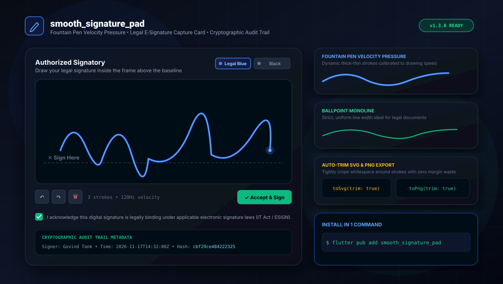

# smooth_signature_pad

<p align="center">
  <a href="https://pub.dev/packages/smooth_signature_pad"></a>
  <a href="https://pub.dev/packages/smooth_signature_pad/score"></a>
  <a href="https://govindtank.github.io/smooth_signature_pad/"></a>
  <a href="https://pub.dev/packages/smooth_signature_pad"></a>
  <a href="https://github.com/govindtank/smooth_signature_pad/actions"></a>
  <a href="LICENSE"></a>
</p>

<p align="center">
  
</p>

A smooth digital signature pad and turnkey `SignatureCaptureCard` for Flutter applications. Features **fountain pen velocity pressure simulation, Catmull-Rom cubic Bézier smoothing, cryptographic audit trail hashing, and auto-trimmed vector SVG & PNG export**.

---

## ⚡ Key Features

| Feature | Description | Real-World Benefit |
|---|---|---|
| **Turnkey `SignatureCaptureCard`** | Complete legal signature capture block with baseline guide and action toolbar | Ready in 3 lines of code |
| **Legal Audit Metadata** | Cryptographic 64-bit FNV-1a hash over stroke coordinates, signer ID, and UTC timestamp | IT Act / ESIGN legal compliance |
| **Ink Color Presets** | One-tap toggle for Legal Blue (`#1E40AF` preferred by banks) and Deep Black | Prevents photocopy confusion |
| **Velocity-Sensitive Fountain Pen** | Dynamic stroke tapering based on gesture velocity (natural thick-thin ink) | Looks like real fountain ink |
| **Auto-Trim Export** | `toSvg(trim: true)` and `toPngBytes(trim: true)` tightly crop whitespace margins | Zero wasted margin in documents |
| **Immediate Contact Points** | Single taps draw crisp periods and accents without requiring drag movement | Enables precise "i" dots and periods |

---

## 🚀 Quick Usage

### 1. Turnkey Legal E-Signing (`SignatureCaptureCard`)

```dart
SignatureCaptureCard(
  title: 'Authorized Signatory',
  subtitle: 'Please sign above the baseline',
  signerName: 'Govind Tank',
  signerId: 'USER-9921',
  documentId: 'DOC-AGREEMENT-2026',
  requireLegalConsent: true,
  onSignatureSaved: (Uint8List pngBytes, String svg, SignatureAuditMetadata audit) {
    print('Signature Hash: ${audit.integrityHash}');
    print('Timestamp: ${audit.timestamp}');
    print('Audit Line: ${audit.auditLine}');
    // Attach pngBytes or svg to your contract / backend
  },
)
```

---

### 2. Lower-Level Custom Signature Pad

```dart
final controller = SignatureController(
  penColor: const Color(0xFF1E40AF), // Legal Blue
  penStyle: PenStyle.fountain,        // or ballpoint, calligraphy
  minStrokeWidth: 1.5,
  maxStrokeWidth: 4.5,
);

SmoothSignaturePad(
  controller: controller,
  showGuideline: true,
  guidelineSignHereText: '✕ Sign Here',
)

// Auto-trimmed Vector SVG & PNG Export
final String svgString = controller.toSvg(trim: true);
final Uint8List? pngBytes = await controller.toPngBytes(trim: true, pixelRatio: 3.0);
```

---

## 💖 Support the Project

If you find this project useful, consider supporting its active maintenance and future development:

<p align="left">
  <a href="https://buymeacoffee.com/govindtanko"></a>
  <a href="https://github.com/sponsors/govindtank"></a>
  <a href="https://www.patreon.com/govindtank"></a>
</p>

---

## 📄 License

This project is licensed under the Apache License 2.0 - see the [LICENSE](LICENSE) file for details.

*Maintained with ❤️ by [Govind Tank](https://github.com/govindtank).*
